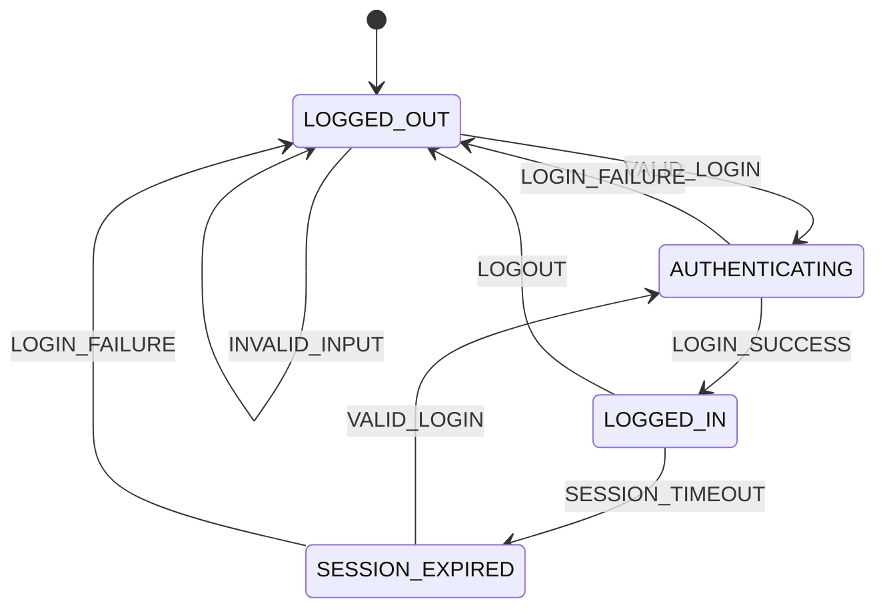

# FLAT: DFA Design for Login and Session Management

## Formal model

Define the DFA as M = (Q, Σ, δ, q0, F).

- Q = {q0, q1, q2, q3}
- Σ = {VALID_LOGIN, INVALID_INPUT, LOGIN_SUCCESS, LOGIN_FAILURE, LOGOUT, SESSION_TIMEOUT}
- q0 = LOGGED_OUT (initial state)
- q1 = AUTHENTICATING
- q2 = LOGGED_IN (accepting/authenticated state)
- q3 = SESSION_EXPIRED
- F = {q2}

The transition function δ is deterministic and total: every state has one defined next
state for every input symbol. See the interactive simulator at `/flat` and its transition table.

## Transition diagram

The web application uses the same four named authentication states in its React auth
controller. The FLAT page is an educational DFA simulator; its controls demonstrate
the formal transition function independently of a live login attempt.
