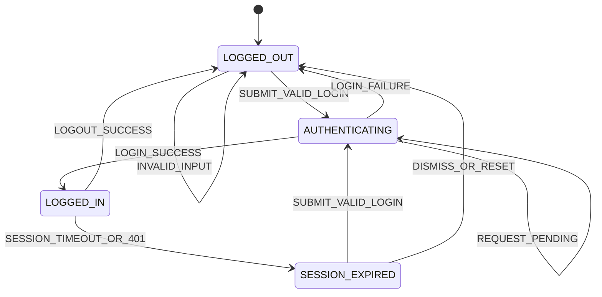

# State Transition Diagram

The frontend authentication controller uses four states:

- `LOGGED_OUT` — no authenticated session is known.
- `AUTHENTICATING` — login request is in progress.
- `LOGGED_IN` — backend confirmed a valid session.
- `SESSION_EXPIRED` — a previously expected session is missing or expired.

## State-machine notes

1. A login request is allowed only after frontend validation passes.
2. `AUTHENTICATING` is temporary while the HTTP request is pending.
3. Only a successful backend response moves the application to `LOGGED_IN`.
4. Invalid credentials return an error and move the UI back to `LOGGED_OUT`.
5. A protected API `401` indicates that the session is no longer valid.
6. The server-side session stored in MongoDB is authoritative; frontend state alone
   does not grant access to protected API data.
